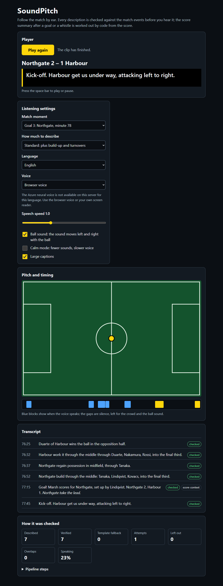
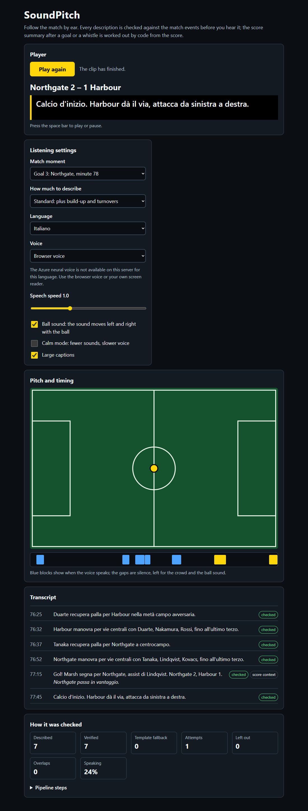

# SoundPitch

**Follow a football match by ear.** SoundPitch turns a stream of synthetic match events into a timed audio description, a ball sound that moves left and right with the play, and large captions, for blind, low-vision, deaf and hard-of-hearing fans. Every description sentence is checked against the match events before anyone hears it; the closing score-context sentence of a goal or a whistle is computed from the score by code (see below).

Built for the [Microsoft x Premier League "Inside the Game" hackathon](docs/hackathon/SUMMARY.md). All data is synthetic: the teams (Northgate Red, Harbour Blue) and the players are invented. This project is not affiliated with, endorsed by or sponsored by Microsoft or the Premier League.

> **Status (21 Oct 2026).** Done and tested: the offline pipeline, the player page, the grounded verifier, the Foundry describer, the usage ledger, the replay mode with 26 recorded Foundry replies that cover all 30 demo windows, the guarded voice endpoint, the cue-sheet JSON export, the score-context sentence (S31) and the Agent Framework workflow. **Hosted demo: offline.** It ran on Azure Container Apps on 2026-10-21 and passed acceptance; its Azure resources were then deleted to stop costs. The tested image is still public on GHCR and the redeploy commands are in [`docs/DEPLOY.md`](docs/DEPLOY.md). Rules 4.8 need a public demo until 10 Nov 2026, 23:59 Pacific: **redeploy before submitting.** **Not done:** Azure AI Speech has never been called (no voice clip exists, so the demo speaks with the browser's own voice), no blind or low-vision listener has tested it. Plan and deadline: [`ROADMAP.md`](ROADMAP.md).

## For judges

**There is no hosted demo at the moment.** One ran on Azure Container Apps on 2026-10-21 (replay mode, verified, see [`docs/DEPLOY.md`](docs/DEPLOY.md)) and was deleted the same day to stop costs; it will be redeployed from the public image before the submission. Until then, run it yourself: GitHub Codespaces or a local clone ("Run it" below), or `docker run -p 8000:8000 ghcr.io/diego-sicignano/soundpitch:09db91c21a048312e1855c45f3629e07d7b6e54d`. Then, on a local copy:

1. Open <http://localhost:8000>, choose **Goal 1: Northgate, minute 16**, press **Play** (or the space bar). Use headphones: the ball sound moves with the play. The goal ends with what it means for the score ("The opening goal of the match.").
2. Open **How it was checked**: how many sentences were verified, how many fell back to a template, the pipeline steps.
3. Try **Italiano**, **calm mode**, the "My own screen reader" output, and the `detail` levels.
4. The same session as JSON for a graphics or captioning system: <http://localhost:8000/api/cuesheet?preset=goal_1> and its [JSON Schema](docs/contracts/cuesheet.v1.schema.json).
5. To see the safety net work, start a second server with `SOUNDPITCH_LLM=always_bad`: every model sentence is wrong, the verifier rejects it three times and a verified template speaks.

The hosted demo (when it is deployed) runs `SOUNDPITCH_LLM=replay`, as the image does by default: words that a Foundry model wrote earlier and the project recorded, checked again by the verifier on every request. It needs no key and makes no model call, so it costs nothing however many judges use it (design: [`docs/DECISIONS.md`](docs/DECISIONS.md) D12).

## What it does

- **Audio description** in English or Italian, at three detail levels: essential (goals and chances), standard (plus build-up and turnovers), full (every phase of play).
- **Ball sound**: one short sound per event. Stereo position follows the ball across the pitch, pitch rises towards the opponent's goal. Different sounds for a pass, a shot, a save, a goal, a whistle.
- **Why the moment matters**: a goal, half-time and full-time end with one sentence on what the score now means ("That makes it level.", "Northgate take the lead.", "Northgate win." at full-time), written by code from the score and never by a model; the page marks it as "score context" (`SPEC.md` §5, D18).
- **Captions** in large type, and a transcript that fills as the match plays. The commentary is marked with its own `lang`, so a screen reader switches voice for Italian.
- **Calm mode**: only goals and whistles make a sound, and the voice slows down.
- **Three outputs**: the browser's own voice (the default, which depends on the voices your browser and system have installed; the page says when there is none for the language), an Azure neural voice (offered only where the server has the stored clips or a Speech key; none exist in this repository yet), or plain text into an `aria-live` region for people who use their own screen reader.
- **A visible plan**: the page draws the pitch and a timeline of when the voice speaks and when it is silent, and a report of what was checked.
- **A machine-readable cue sheet** (`/api/cuesheet`) with versioned JSON Schema, and WebVTT captions.

## Screenshots

Local run in replay mode (recorded Foundry replies, no network), window "Goal 3: Northgate, minute 78", after playback. The goal sentence is verified; the italic closing sentence with the "score context" badge is written by code from the score and is not covered by the verifier.





## How it works

```
 synthetic match ──> moments ──> describer ──> verifier ──> timing planner ──> cues, earcons, captions
 (1 event / 3-9 s)   (priority)   templates,     names,       fits speech into    WebVTT, cue sheet
                                  recorded or    numbers,     the silence
                                  live model     facts
                                      ^              |
                                      └── 2 retries ─┘  then the verified template fallback
```

Only code decides **what is true** and **when it is said**; a model only chooses words. A sentence that fails verification is sent back twice, then the deterministic template (which always verifies) speaks and the cue is marked `fallback`. After verification, code appends to a goal, half-time or full-time sentence one more, chosen from the score alone, on what the moment means ("That makes it level.", "Northgate take the lead.", "Northgate win."). It is kept apart in `Cue.context` and is not checked by the verifier (S31, D18). A longer walk through the code, with a reading order: [`docs/ARCHITECTURE.md`](docs/ARCHITECTURE.md).

| Stage (hackathon wording) | Module |
|---|---|
| Ingest | `backend/app/match_gen.py`: a seeded possession simulation with a pinned storyline (goals at 16', 52', 78'; final score 2-1) |
| Interpret | `moments.py`: events grouped into moments with priority 0 to 3 |
| Explain | `describer.py` (templates), `foundry.py` (a model on Microsoft Foundry), `replay.py` (its recorded replies) |
| Verify | `verifier.py`: refs equal the facts the code derives; relations only as code-built phrases; every other word from a closed vocabulary; names and phrases only where a template puts them |
| Context | `stakes.py`, applied by `pipeline.apply_context`: one fixed sentence on what the score now means, for goals, half-time and full-time; not model output |
| Render | `timing.py`, `render.py`, `cuesheet.py` |
| Personalize | `Profile` in `contracts.py`: detail, language, ball sound, calm mode, speech rate, output |
| Orchestrate | `pipeline.py` (plain), `workflow.py` (the same steps as a Microsoft Agent Framework graph) |

**What the verifier proves, and what it does not.** Every name, team, number, score, minute and position in a sentence comes from the moment's own facts, and every other word comes from a reviewed list. It does **not** prove that prose built from allowed words means what it should: "Foul of Harbour." is accepted, for example (`SPEC.md` §5, D9). Natural wording written without the list is mostly rejected and the template speaks instead (`docs/evaluation.md`).

## Microsoft technologies actually used

| Technology | Where | State |
|---|---|---|
| Microsoft Foundry (`gpt-4.1-mini`, Global Standard) | `foundry.py` writes the words; evidence in [`docs/evidence/foundry-run.md`](docs/evidence/foundry-run.md) | run live twice on 20 Oct 2026; the second run is recorded in the replay file (26 replies, about 0.03 USD); it mostly repeats the template wording |
| Microsoft Agent Framework | `FoundryChatClient` in `foundry.py`; the workflow graph in `workflow.py` (optional packages) | built and tested; it orchestrates, the model is not an autonomous agent |
| Azure AI Speech | `tts.py` | written, tested against a stub, **not run with a real key** |
| Azure Container Apps | `Dockerfile`, [`docs/DEPLOY.md`](docs/DEPLOY.md) | deployed and verified 2026-10-21 (Consumption only, scale to zero, one replica at most, 0.25 vCPU and 0.5 GiB, the public image of the commit `09db91c`, no secret, no key, no model call), then **deleted the same day**; **not hosted now** |
| GitHub Actions | `.github/workflows/ci.yml` | backend, SDK, end-to-end and Docker jobs green on `09db91c` ([run](https://github.com/diego-sicignano/soundpitch/actions/runs/39622166407)); started by hand (`workflow_dispatch`) because push-triggered runs did not start, see `docs/DEPLOY.md`; the same run published the image to GHCR |

## Run it

Python 3.13 or later and Node.js (only for the end-to-end tests). Windows PowerShell shown; on macOS or Linux use `.venv/bin/python`.

```powershell
cd backend
python -m venv .venv
.\.venv\Scripts\python.exe -m pip install -r requirements-dev.txt
.\.venv\Scripts\python.exe -m uvicorn app.main:app --port 8000
```

Open <http://localhost:8000>. The same server serves the page and the API, offline.

**In a browser, with no install: GitHub Codespaces.** On the repository page choose Code, Codespaces, Create codespace on main. The dev container (`.devcontainer/devcontainer.json`) builds the Python 3.13 environment, installs the backend and test dependencies and Playwright's Chromium (a few minutes). Then, in its terminal: `cd backend && .venv/bin/python -m uvicorn app.main:app --port 8000` and open the forwarded port 8000. Tests: `cd backend && .venv/bin/python -m pytest -q`, and from the root `npm run e2e`. Verified by building the container locally and running the tests in it; a Codespace itself has not been started. URL options for demos: `?preset=goal_2`, `?speed=10` (run the clock 10 times faster), `?speech=off` (no sound).

Optional, for the Foundry describer and the workflow: `.\.venv\Scripts\python.exe -m pip install -r requirements-agents.txt` (Python 3.13), `az login`, set `FOUNDRY_PROJECT_ENDPOINT` and `FOUNDRY_MODEL`. Settings are environment variables; copy `backend/.env.example` to `backend/.env` (git-ignored) and load it into the shell that starts the server:

```powershell
Get-Content .env | ForEach-Object { if ($_ -match '^\s*([^#=\s][^=]*?)\s*=\s*(.*)$') { Set-Item ("env:" + $matches[1]) $matches[2] } }
```

| Variable | Meaning |
|---|---|
| `SOUNDPITCH_LLM` | `scripted` (default, templates); `replay` (recorded Foundry replies, no network; `/api/health` shows how many are held); `foundry` (a live model, needs the packages, the two settings below and the cost ledger); `bad_then_good`, `always_bad` plant errors to show the retry and the fallback; any other value is a `503 llm_not_configured` that names the setting and never the value (also on `/api/health`) |
| `SOUNDPITCH_ORCHESTRATOR` | `plain` (default) or `workflow` (Agent Framework graph; needs `requirements-agents.txt`) |
| `FOUNDRY_PROJECT_ENDPOINT`, `FOUNDRY_MODEL` | The Foundry project and the deployment for `SOUNDPITCH_LLM=foundry`. `az login`; no key is used |
| `SOUNDPITCH_LLM_CALLS_PER_MINUTE`, `..._PER_DAY`, `SOUNDPITCH_LLM_TOKENS_PER_DAY`, `SOUNDPITCH_LLM_EUR_PER_MONTH`, `SOUNDPITCH_USAGE_DB` | Cost limits of the live model, kept in one SQLite file: default 2 a minute, 20 a day, 120,000 tokens a day, 2.00 EUR a month of estimated spend (never above 4.00). Over a limit, or if the file cannot be used, the call is not made and the template speaks (D11) |
| `AZURE_SPEECH_KEY`, `AZURE_SPEECH_REGION` | Enable the live path of `POST /api/tts`; the "Azure neural voice" output is offered when these are set or when stored clips exist for the language (`GET /api/voice`); otherwise the page uses the browser voice |
| `SOUNDPITCH_TTS_PER_CLIENT_PER_MINUTE`, `SOUNDPITCH_TTS_PER_MINUTE`, `SOUNDPITCH_TTS_CHARS_PER_DAY`, `SOUNDPITCH_TTS_CHARS_PER_MONTH`, `SOUNDPITCH_TRUST_PROXY` | Brakes on the voice endpoint (defaults 30, 120, 60,000, 300,000); `SOUNDPITCH_TRUST_PROXY=1` only behind exactly one trusted proxy (SPEC §8); `SOUNDPITCH_LOG_FORWARDED=1` logs the shape of `X-Forwarded-For`, never an address |

## API

| Method | Path | Result |
|---|---|---|
| `GET` | `/api/match`, `/api/presets` | teams and final score; the windows `kickoff`, `goal_1`, `goal_2`, `goal_3`, `final_whistle` |
| `GET` | `/api/session?preset=goal_1&detail=standard&lang=en&earcons=true&calm=false&rate=1` | cues with millisecond timings, earcons, ball track, trace, report |
| `GET` | `/api/session.vtt?...` | the same cues as WebVTT captions |
| `GET` | `/api/cuesheet?...`, `/api/cuesheet.schema.json` | the session as a versioned cue sheet, and its JSON Schema |
| `GET` | `/api/voice` | What the Azure voice can do on this server: stored clips per language, and whether Speech is configured |
| `POST` | `/api/tts` | `audio/mpeg`, a stored clip or Azure AI Speech, only for text a session returned (`403` otherwise); `X-Audio-Rate` says the speed the audio already has |
| `GET` | `/api/health` | status and describer mode |

Errors are `{code, message}`; the full contract is `SPEC.md` §8 and `backend/app/contracts.py`.

## Tests and evaluation

```powershell
cd backend; .\.venv\Scripts\python.exe -m pytest -q; cd ..        # the offline suite
cd backend; .\.venv\Scripts\python.exe -m ruff check .; cd ..
npm install; npm run e2e                                           # browser tests with axe-core
cd backend; .\.venv\Scripts\python.exe -m app.smoke http://localhost:8000; cd ..   # checks a running server
```

Tests that need the optional Agent Framework packages (the workflow and the SDK adapter) are skipped unless `requirements-agents.txt` is installed; CI runs them in a separate job. `npm run e2e` starts three servers itself (ports 8100 to 8102).

`python -m app.evaluate --seeds 20` counts, over 600 generated sessions, and writes [`docs/evaluation.md`](docs/evaluation.md): 0 overlapping cues, every must-say moment spoken, and the verifier's behaviour on planted errors and on hand-written commentary. **Read the limits there:** the planted errors are the kinds the verifier was built to catch, so they show the checks work, not how accurate a model is; the hand-written corpora are small (24 to 44 sentences).

## Docker

```powershell
docker build -t soundpitch .
docker run -p 8000:8000 soundpitch
```

The image runs `SOUNDPITCH_LLM=replay` as a non-root user and needs no writable path, key or network. It was built and run on Docker here with `--read-only --cap-drop ALL`, with and without network, and passed the smoke check; the `docker` job in `.github/workflows/ci.yml` repeats that when the workflow runs. The voice of the public demo is meant to come from stored clips (`backend/app/audio/`, made once with `python -m app.clips_build`; **none exist yet**, so the image speaks with the browser voice until they are made). The image of each tested commit is published on GHCR (`docker pull ghcr.io/diego-sicignano/soundpitch:<commit sha>`, public, no login). Deployment: [`docs/DEPLOY.md`](docs/DEPLOY.md).

## Honest limits

- No blind or low-vision listener has tested it. The style follows public guidance (RNIB, Sky Sports' radio-style description) and is unvalidated.
- The match is generated, so pitch positions are plausible, not measured.
- The verifier checks where facts and words come from, not the meaning of a sentence (see above).
- The score-context sentence (S31) is not checked by the verifier: it is a fixed phrase picked by code from the score, covered by tests. Its Italian wording was written by the assistant (singular verb with a club name, "Northgate passa in vantaggio") and has not been reviewed by a native speaker; the Italian templates were corrected to the same singular on 2026-10-21 (D20). The recorded Italian sentences that kept the old plural wording are now rejected by the verifier and replaced by the templates, so 14 of the 15 Italian demo sessions report 2 attempts and every moment is still verified; re-recording the Italian windows would restore the model's own words.
- The Foundry model copies the template sentences in most cues (own wording in 0% of English and 13.6% of Italian cues in the recorded run, 1.2% and 16.0% in an earlier one, `docs/evidence/foundry-run.md`), so today it adds little wording of its own. One of its Italian sentences is not good Italian and the verifier accepted it, because it does not check meaning; it is kept as recorded and documented, and the owner reviewed the other eight Italian sentences the model wrote. The figures are two runs of one deployment.
- Model spending is limited by the application, not by Azure: the 5 EUR budget only sends e-mail, 8 to 24 hours late, and pay-as-you-go has no cutoff. The ledger counts estimates, per host (D11). The judges' path makes no model call.
- Speech spending is limited only by the pricing tier of the Speech resource; the application's limits live in memory and restart at zero (SPEC §8).
- The browser voice varies by browser and operating system.
- Azure credit: about USD 0.05 of the project's early Foundry testing (2026-10-20) was charged against an Azure for Students credit before the work moved to a pay-as-you-go subscription; all recorded replies were made on the paid one. No grant, sponsorship, contract or licence from Microsoft is involved. Details and the open reading of rule 4.12: [`docs/hackathon/COMPLIANCE.md`](docs/hackathon/COMPLIANCE.md), D23.

## Built with AI assistance

This repository was written with the help of an AI coding assistant (Claude Code). The specification, the acceptance rows and the reasons for each choice are in [`SPEC.md`](SPEC.md), [`ROADMAP.md`](ROADMAP.md) and [`docs/DECISIONS.md`](docs/DECISIONS.md); [`CLAUDE.md`](CLAUDE.md) is the instruction file the assistant works from. The owner set the goal, wrote the rules the assistant follows (including the approval gates for anything that spends money or is hard to undo), approved the live model runs and the external steps, and reviewed the recorded Italian; the repository records those decisions, and says plainly that it cannot prove how much of the text was typed by whom. What the rules, the tool terms and Italian and US copyright guidance say about that is read in [`docs/hackathon/COMPLIANCE.md`](docs/hackathon/COMPLIANCE.md).

## Repository map

```
SPEC.md            behaviour, test ids, acceptance rows S1-S32
CONTEXT.md         glossary and the map of the data contracts
ROADMAP.md         done, tickets, schedule
CLAUDE.md          instructions for the coding assistant used on this repo
backend/app/       the pipeline, the API, the verifier, the describers, the workflow
backend/tests/     pytest suite
frontend/          index.html, app.js, styles.css (no build step)
e2e/               Playwright tests with axe-core
docs/              architecture, deploy, decisions, evaluation, evidence, contracts, screenshots, hackathon rules, submission drafts
.github/           CI: backend tests, SDK tests, end-to-end tests, Docker build and smoke
```

## Licence and third-party software

[MIT](LICENSE). The hackathon rules grant Microsoft and the Premier League a licence to use submissions (section 7 of the rules). The Official Rules and Microsoft's playlist page are not redistributed here (their source repository is MIT licensed, but the rules also reserve all rights; see `docs/hackathon/README.md`); the rule-by-rule review is in [`docs/hackathon/COMPLIANCE.md`](docs/hackathon/COMPLIANCE.md).

Runtime: FastAPI, Pydantic (MIT), Uvicorn, httpx (BSD-3-Clause). Optional: Microsoft Agent Framework, Azure SDK for Python (MIT), OpenAI Python SDK (Apache-2.0). Development and tests: pytest, Ruff (MIT), Playwright (Apache-2.0), axe-core (MPL-2.0, used as a test tool, not shipped). Versions are pinned in `backend/requirements*.txt` and `package-lock.json`; licences were read from the installed package metadata on 2026-10-20. The page uses no external script, font, image or sound: the ball sounds are synthesised in the browser. `docs/hackathon/OFFICIAL_RULES.md` is a verbatim copy of a file from `microsoft/insidethegamehackathon` (MIT).
